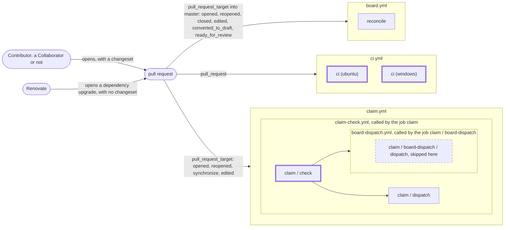
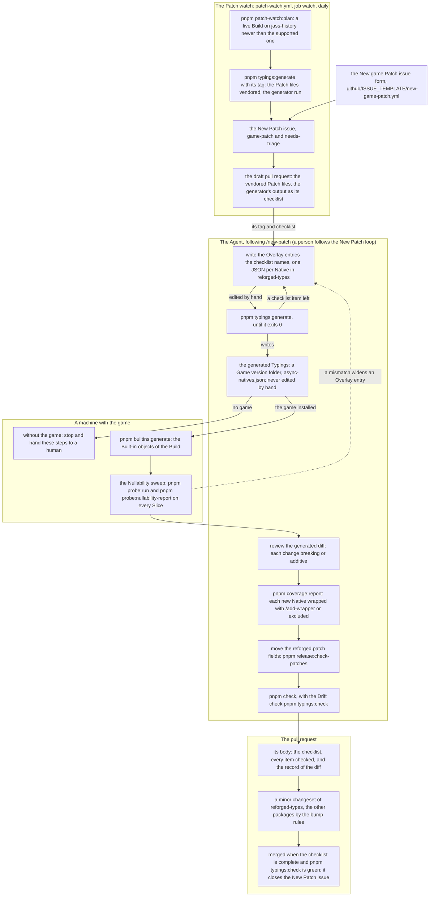

# Contributing to reforged-ts

Thanks for helping. This guide is for people; AI coding agents follow [`AGENTS.md`](AGENTS.md), which points at the same rules. The project's words (Native, Handle, Wrapper, System, Typings, Overlay, Patch, Build) are defined in [`GLOSSARY.md`](GLOSSARY.md), and the decisions behind the rules below are the ADRs in [`docs/adr/`](docs/adr/).

The [README](README.md) has the requirements (Node, pnpm 12), every root command and the version policy, which says when pnpm refuses a dependency. After `pnpm install`, `pnpm check` should pass on a fresh clone.

## Pull requests

1. **Branch from `master`**, in a fork or in this repository.
2. **One topic per pull request.** A bug fix, a Wrapper, a Patch: each is its own pull request, so each maps to one changeset and one changelog entry.
3. **Fill in the template.** Its checklist is the list of release gates below; tick what applies and say why for what does not.
4. **CI runs on every pull request** and must pass. `master` is protected by a ruleset that requires three checks by name, **`ci (ubuntu)`** and **`ci (windows)`**, the two legs of the `ci` job in `.github/workflows/ci.yml`, one per operating system, and **`claim / check`**, the `claim` check of `.github/workflows/claim.yml` (see "Taking an issue"). The names are a contract. Renaming a job or the matrix values silently stops protecting `master`, so a pull request that renames them updates the ruleset in the same change. The Template's `main` is protected by a ruleset that exists on GitHub only, set by hand with `gh api`: it requires `ubuntu-latest`, `windows-latest` and `claim / check`.
5. **Squash merge.** Each pull request lands as one commit on `master`, and its title becomes the commit subject. Write the title the way the history reads: a [Conventional Commits](https://www.conventionalcommits.org/) type and scope, then what it does (`fix(release): check out before the App token step`).

### Done means `pnpm check`

`pnpm check` runs lint, typecheck, build, the Typings Drift check, the Built-in objects' Drift check (`pnpm builtins:check`), the diagrams' Drift check (`pnpm diagrams:check`), the tests, the Wrapper coverage report and the docs audit (`pnpm docs:audit`), in that order, and stops at the first failure. Green on your machine is the definition of done, and CI runs the same package scripts on ubuntu and windows, so a green local run predicts a green CI run. On ubuntu, CI also runs the release checks (`pnpm release:check-changeset` on a pull request, `pnpm release:gate`, `pnpm release:check-patches`), actionlint on the workflows (`pnpm actionlint` locally) and, on a pull request that changes `renovate.json5` or the root `package.json`, Renovate's validator (`pnpm renovate:check`). There are no git hooks: run it before you push.

### The CI of a pull request

What a pull request runs, generated from the workflows and the committed ruleset (`.github/rulesets/master.json`): the three checks the ruleset requires have a thick border, and the table under the diagram lists the steps of `ci.yml` in order, to compare with the stages of `pnpm check` above.

<!-- diagram:pull-request-ci generated by pnpm diagrams:generate, never edit by hand -->



| #   | Step of `ci.yml`                | `if`                                                                                                                                                                                                                                           |
| --- | ------------------------------- | ---------------------------------------------------------------------------------------------------------------------------------------------------------------------------------------------------------------------------------------------- |
| 1   | `Line endings as committed`     | `matrix.os == 'windows'`                                                                                                                                                                                                                       |
| 2   | `actions/checkout`              |                                                                                                                                                                                                                                                |
| 3   | `install`                       |                                                                                                                                                                                                                                                |
| 4   | `lint`                          |                                                                                                                                                                                                                                                |
| 5   | `typecheck`                     |                                                                                                                                                                                                                                                |
| 6   | `build`                         |                                                                                                                                                                                                                                                |
| 7   | `typings:check`                 |                                                                                                                                                                                                                                                |
| 8   | `builtins:check`                |                                                                                                                                                                                                                                                |
| 9   | `diagrams:check`                |                                                                                                                                                                                                                                                |
| 10  | `test`                          |                                                                                                                                                                                                                                                |
| 11  | `coverage:report`               |                                                                                                                                                                                                                                                |
| 12  | `Upload the coverage report`    | `!cancelled() && steps.coverage-report.outcome != 'skipped' && hashFiles('wrapper-coverage/report.json', 'wrapper-coverage/report.md') != ''`                                                                                                  |
| 13  | `data:check`                    |                                                                                                                                                                                                                                                |
| 14  | `examples:build`                |                                                                                                                                                                                                                                                |
| 15  | `probe:build`                   |                                                                                                                                                                                                                                                |
| 16  | `docs:audit`                    |                                                                                                                                                                                                                                                |
| 17  | `docs:check`                    | `matrix.os == 'ubuntu'`                                                                                                                                                                                                                        |
| 18  | `release:check-changeset`       | `matrix.os == 'ubuntu' && github.event_name == 'pull_request' && !(github.head_ref == 'changeset-release/master' && github.event.pull_request.head.repo.full_name == github.repository) && !cancelled() && steps.install.outcome == 'success'` |
| 19  | `release:gate`                  | `matrix.os == 'ubuntu' && !cancelled() && steps.install.outcome == 'success'`                                                                                                                                                                  |
| 20  | `release:check-patches`         | `matrix.os == 'ubuntu' && !cancelled() && steps.install.outcome == 'success'`                                                                                                                                                                  |
| 21  | `renovate:check`                | `matrix.os == 'ubuntu' && github.event_name == 'pull_request' && !cancelled() && steps.install.outcome == 'success'`                                                                                                                           |
| 22  | `Pack the publishable packages` | `matrix.os == 'ubuntu' && github.event_name == 'push'`                                                                                                                                                                                         |
| 23  | `Upload the tarballs`           | `matrix.os == 'ubuntu' && github.event_name == 'push'`                                                                                                                                                                                         |
| 24  | `actionlint`                    | `matrix.os == 'ubuntu' && !cancelled()`                                                                                                                                                                                                        |

<!-- /diagram:pull-request-ci -->

A pull request, opened by a contributor (a Collaborator, or anyone else through a fork) or by Renovate, triggers three workflows. `ci.yml` runs on `pull_request`, its `ci` job once per operating system: each leg is a required check. `claim.yml` runs on `pull_request_target` and calls the reusable `claim-check.yml`: its `check` job is the claim check, a required check, and its `dispatch` and `board-dispatch` jobs tell the Claim board after an assignment the check made, `dispatch` in this repository and `board-dispatch` in the Template: here `board-dispatch` and the job it calls in `board-dispatch.yml`, the check `claim / board-dispatch / dispatch`, are always skipped, drawn dashed, since their condition holds only in the Template. `board.yml` reconciles the Claim board. Renovate's pull requests run the same checks, `claim / check` skipped as on every bot's pull request (a skipped check counts as passed), and carry no changeset (see "Changesets"). The table lists a step's `if` when it has one; a step without one runs when the steps before it passed.

| Node                                                                                                                           | Read                                                                                                                     |
| ------------------------------------------------------------------------------------------------------------------------------ | ------------------------------------------------------------------------------------------------------------------------ |
| `ci.yml`, `ci (ubuntu)`, `ci (windows)`                                                                                        | [Done means `pnpm check`](#done-means-pnpm-check), and each release check in [`docs/release.md`](docs/release.md)        |
| `claim.yml`, `claim-check.yml`, `claim / check`, `claim / dispatch`, `board-dispatch.yml`, `claim / board-dispatch / dispatch` | [Taking an issue](#taking-an-issue), and "Claim" in [`docs/agents/issue-tracker.md`](docs/agents/issue-tracker.md#claim) |
| `board.yml`, `reconcile`                                                                                                       | [The board](docs/release.md#the-board)                                                                                   |
| Contributor, Renovate                                                                                                          | [Changesets](#changesets)                                                                                                |

### Changesets

Every pull request carries a changeset: a file in `.changeset/` naming the packages it releases and their bumps, whose text is the changelog entry a Map project author reads. Add one with `pnpm changeset`. Each package is versioned on its own ([ADR 0009](docs/adr/0009-independent-semver-with-changesets-and-patch-field.md)): a **major** when its public API breaks, a **minor** when something is added (a Wrapper member, a lint rule, the Natives of a new Patch), a **patch** for a fix that changes no API, and an **empty** changeset when nothing publishable changes (the website, CI, a test). Two kinds of pull request add none: one that only deletes stranded empty changesets, which says so in its description, and Renovate's dependency upgrades, which change only the catalog in `pnpm-workspace.yaml`, the lockfile, the root `package.json`, `.node-version` and `.github/`, never a file inside a published package: a package's dependencies are `catalog:` or `workspace:` references, and Renovate leaves its peer ranges and `engines` alone. When an upgrade moves a catalog range a package publishes, its pull request description says so, and a changeset naming that package is added before merging.

[`docs/release.md`](docs/release.md) has the rules in full: the non-interactive commands, what a major of the library requires, the bumps for a new Patch and the deprecation policy.

## Tests on the harness

The library's tests are TypeScript files compiled to Lua by typescript-to-lua and run on real Lua 5.3 by [`reforged-test`](packages/reforged-test/README.md), the harness, with the Natives stubbed in Lua; vitest reports them. Every library change comes with a test there. [`packages/reforged-ts/test/README.md`](packages/reforged-ts/test/README.md) explains how to write one: the helpers, firing triggers and timers, overriding a Native for one test, simulating several game clients.

```sh
pnpm test                                        # everything, as pnpm check runs it
pnpm --filter reforged-ts test                   # the library's tests only
pnpm --filter reforged-ts test -t timer.test.ts  # one file's tests: each file is a describe named after it
```

## Wrappers

- **Naming.** A Wrapper is named after its Native type, capitalised (`timer` is `Timer`, `unit` is `Unit`), unless that name collides with a Native function; then it takes a descriptive noun (`rect` is `Rectangle` because `Rect` is a Native, `player` is `MapPlayer` because `Player` is one). The Handle base's doc comment (`packages/reforged-ts/src/handles/handle.ts`) holds this rule with the others every Wrapper follows: no public constructor, creation throws, lookup returns `undefined`.
- **Coverage.** A Wrapper covers every Native its Handle type owns: the Natives whose first parameter is that type, and the creation Natives that return it ([ADR 0008](docs/adr/0008-wrapper-coverage-rule-and-no-bj-mirroring.md)). The coverage report, `pnpm coverage:report` (run by `pnpm check` and CI), lists every owned Native with the member that calls it and fails on one without. When an owned Native should not be wrapped, exclude it in the report's exclusions file with its name, the date and a reason that cites a source, such as a community bug note or a measurement in the game ("not useful" is not a reason). An exclusion for a Native that is now called, or that no longer exists, fails the report too.
- **Blizzard.j is never mirrored.** Its `*BJ` functions exist for the GUI trigger editor and share global state (`bj_lastStartedTimer`); whatever is useful in one is reimplemented over Natives. A Map project can still call them through the Typings, and the lint plugin's `no-unsafe-natives` rule bans the harmful ones.

The README's [Rules for library code](README.md#rules-for-library-code) apply to every change in the library.

## The Typings and a new Patch

The Typings are generated from the game's Patch files and the Overlay. Never edit the generated files (the Game version folders such as `packages/reforged-types/3.0.1/`, their `.d.ts` entries, `async-natives.json`): `pnpm typings:check` fails on any difference from what the generator writes.

**Curating the Overlay.** A fact about a Native (its nullability, a deprecation, whether its value is async, a note) goes in its Overlay entry: one JSON file per Native under `packages/reforged-types/overlay/<Patch file>/functions/` or `globals/`, shaped like its neighbours. Run `pnpm typings:generate` and commit the entry with the regenerated output; the pull request is where the curation is reviewed. The curation rules and the generator's messages are in [`packages/reforged-types/AGENTS.md`](packages/reforged-types/AGENTS.md); they are the project's rules for everyone, not only for agents.

A Patch's adoption end to end, by actor: the Patch watch opens the work, an Agent (or a person) curates the Overlay and regenerates the Typings, a machine with the game runs what only the game can tell, and the pull request carries the result.



| Node                                                                                           | Details in                                                                                                                                                                                                                  |
| ---------------------------------------------------------------------------------------------- | --------------------------------------------------------------------------------------------------------------------------------------------------------------------------------------------------------------------------- |
| The issue form                                                                                 | [`new-game-patch.yml`](.github/ISSUE_TEMPLATE/new-game-patch.yml); step 1 below                                                                                                                                             |
| The Patch watch: the plan, the generation, the issue, the draft                                | [`patch-watch.yml`](.github/workflows/patch-watch.yml); steps 1 and 2 below                                                                                                                                                 |
| The Overlay entries, `typings:generate` until it exits 0                                       | "Curating the Overlay" above; steps 1 to 4 of the [New Patch loop](packages/reforged-types/AGENTS.md#new-patch-loop) and its [Curation rules](packages/reforged-types/AGENTS.md#curation-rules)                             |
| The generated Typings, never edited by hand                                                    | The first paragraph of this section                                                                                                                                                                                         |
| `builtins:generate` and the Nullability sweep, on a machine with the game; the stop without it | Steps 5 and 6 of the [New Patch loop](packages/reforged-types/AGENTS.md#new-patch-loop) and of the [`new-patch` skill](.claude/skills/new-patch/SKILL.md); [What stays for a human](probe/README.md#what-stays-for-a-human) |
| The review of the diff, the coverage, the `reforged.patch` fields                              | Steps 7 to 9 of the [`new-patch` skill](.claude/skills/new-patch/SKILL.md); [The `reforged.patch` field](docs/release.md#the-reforgedpatch-field)                                                                           |
| `pnpm check`                                                                                   | Step 11 of the [`new-patch` skill](.claude/skills/new-patch/SKILL.md); step 8 of the [New Patch loop](packages/reforged-types/AGENTS.md#new-patch-loop)                                                                     |
| The pull request: its checklist, its changesets, the merge                                     | Steps 10 and 12 of the [`new-patch` skill](.claude/skills/new-patch/SKILL.md); [Choosing the bump for a Patch](docs/release.md#choosing-the-bump-for-a-patch); step 4 below                                                 |

**How a new Patch flows.**

1. The Patch watch reads [jass-history](https://github.com/Luashine/jass-history) daily. When a live Build newer than the supported one is tagged, it opens a "New Patch" issue (`game-patch`, `needs-triage`) and a draft pull request that vendored the Patch files and ran the generator. If you notice a Patch first, report it with the "New game Patch" issue form.
2. The draft pull request's body is the generator's output as a checklist: each Native without an Overlay entry, each signature that no longer matches.
3. Curation is human, following the [New Patch loop](packages/reforged-types/AGENTS.md#new-patch-loop): write the missing entries, regenerate until the generator passes, settle the `reforged.patch` fields.
4. It merges when the checklist is complete, `pnpm typings:check` is green and the pull request carries a minor changeset for `reforged-types` ([Choosing the bump for a Patch](docs/release.md#choosing-the-bump-for-a-patch) gives the other packages' bumps).

## Documentation

Every exported symbol and public member of the library has a doc comment in TSDoc syntax, checked by lint against one shared `tsdoc.json` ([ADR 0004](docs/adr/0004-tsdoc-standard-with-compiled-examples.md)). [Documenting the library](docs/documentation.md) is the standard those comments follow: the tag vocabulary and order, the [required-tag matrix](docs/documentation.md#required-tags-per-symbol-kind) per symbol kind, the style rules, and the examples convention. In short: the first sentence is an imperative summary that does not restate the signature, `@param name - description` gives units and ranges, caveats go in one `@remarks`, a member backed by a Native carries `@native`, anything added after 1.0.0 carries `@since` with the library version, and nothing is copied from jassdoc, which has no licence. An `@example` is never written inline: it includes a file, or a region of one, under `packages/reforged-ts/examples/`: `harness/` for an example that runs on the Lua harness with the Native stubs, `game/` for one that needs the game. CI compiles every example and the library's tests run those under `harness/`, so an example cannot rot. A change a guide describes updates that guide on the docs site (`website/docs/`), and a renamed or removed public symbol gets its `renames.json` entry (`packages/reforged-ts/migration/`) and the migration page of its major ([The major-changeset gate](docs/release.md#the-major-changeset-gate)).

## Issues and labels

Open an issue with one of the forms: **Bug report**, **Feature request** or **New game Patch**. An issue about the Template goes to its own repository, `phmilk/reforged-ts-template`. Questions about how to do something in a map go to [Hive Workshop, Triggers & Scripts](https://www.hiveworkshop.com/forums/triggers-scripts.269/), and the [docs site](https://phmilk.github.io/reforged-ts) has the guides.

Each form applies its kind label (`bug`, `enhancement` or `game-patch`) and `needs-triage`. The triage label then tells you where your issue stands:

| Label             | What it means for you                                                                                                                                                                 |
| ----------------- | ------------------------------------------------------------------------------------------------------------------------------------------------------------------------------------- |
| `needs-triage`    | New: the maintainer has not evaluated it yet.                                                                                                                                         |
| `needs-info`      | The maintainer is waiting for you. Answer the question in the comments and the issue goes back to triage.                                                                             |
| `ready-for-agent` | Accepted and specified in full; an AI coding agent will implement it. Assign yourself before you start on one.                                                                        |
| `ready-for-human` | Accepted, and it needs a person: a judgement call, or a check in the game [a Probe run cannot make](probe/README.md#what-stays-for-a-human). Assign yourself before you start on one. |
| `wontfix`         | It will not be done; the closing comment says why.                                                                                                                                    |

The `spec` and `ticket` labels mark the maintainer's planning issues (a spec and the tickets it is split into). [`docs/agents/triage-labels.md`](docs/agents/triage-labels.md) is the reference.

### Taking an issue

An issue is taken by its assignee. Before you start on one, assign yourself (`gh issue edit <n> --add-assignee @me`, or the sidebar), before the branch, the first commit, any comment and the pull request; an AI coding agent you run writes as you, so this covers it too. One login per issue: an issue assigned to someone else is theirs, so coordinate with them instead of opening a second pull request. Without push access you cannot assign yourself: comment on the issue instead, which lets GitHub assign you, and the `claim` check assigns you when your pull request opens. The same check fails a pull request that would close an issue assigned to someone else, with the way out in its comment; the ruleset requires it, so a red check blocks the merge. An assignment goes stale after 3 days without a commit on its pull request and without a comment: comment on the issue, then take it over. The maintainer may reassign at any time. The rule in full, specs included, is the Claim section of [`docs/agents/issue-tracker.md`](docs/agents/issue-tracker.md#claim), decided in [ADR 0016](docs/adr/0016-the-assignee-is-the-claim-and-the-board-is-a-derived-view.md).

## The maintainer's repository setup

The one-time setup of this repository is the maintainer's, not a contributor's: the GitHub App the workflows open their pull requests with, its client ID and private key ([docs/release.md, Prerequisites outside this repository](docs/release.md#prerequisites-outside-this-repository)), the npm side of publishing ([Human steps](docs/release.md#human-steps)), the Renovate GitHub App, installed on this repository only, which opens the weekly dependency pull requests of [`renovate.json5`](renovate.json5), and the Claim board with the token its workflow writes with ([docs/release.md, The board](docs/release.md#the-board)). `bash release/repo-setup.sh` (`--dry-run` to review it first) walks through the App, Renovate, `pnpm repo:settings` below and the board, and checks each step: see [the repository-setup wizard](docs/release.md#the-repository-setup-wizard).

The repository's own settings are committed: the ruleset on `master` in [`.github/rulesets/master.json`](.github/rulesets/master.json) (a pull request, both CI legs, linear history, no force push or deletion, the administrator may bypass), and the merge settings (squash only, auto-merge, head branches deleted), the Pages source (GitHub Actions) and the labels in `release/src/repo-settings.ts`. `pnpm repo:settings` makes the repository match them through the GitHub API, as the `gh` login, which must be an administrator of the repository; run `pnpm repo:settings --dry-run` first, it prints every request and sends none. `--repo <owner/name>` targets another repository, such as a fork.
