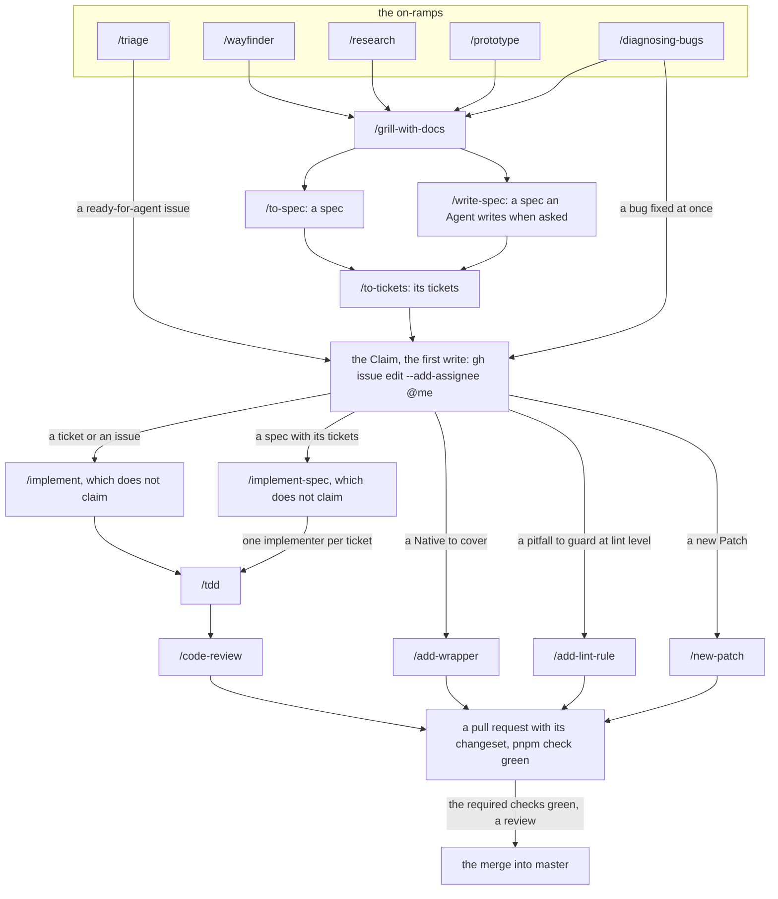

# The development loop

The development loop takes a piece of work from an on-ramp to a merged pull request, one Agent skill per step. Most of its Agent skills live outside this repository.

## Where the Agent skills come from

- **External.** Every skill of the loop but the repository's own comes from [`mattpocock/skills`](https://github.com/mattpocock/skills), installed once per agent on each machine, never committed here. In Claude Code:

  ```sh
  claude plugin install mattpocock-skills@claude-plugins-official
  ```

  Any other agent takes editable copies with `npx skills@latest add mattpocock/skills -a <agent>`, and the upstream README's [Installation](https://github.com/mattpocock/skills#installation-30-second-setup) gives the plugin commands of Codex, Copilot and Gemini. Pick one way per agent: both install every skill twice. Checked against that README on 2026-10-22.

- **Set up for this repository.** The three agents docs, [`issue-tracker.md`](issue-tracker.md), [`triage-labels.md`](triage-labels.md) and [`domain.md`](domain.md), are the output of `/setup-matt-pocock-skills`, with the "Agent skills" block of [`AGENTS.md`](../../AGENTS.md#agent-skills) that points at them. The external skills read them for this repository's tracker, labels and domain docs; the repository has since edited them (the Claim, the kind labels), so they are its own: change a convention there, never in a skill.
- **The repository's.** The project skills `add-wrapper`, `add-lint-rule` and `new-patch`, and the Skill variant `write-spec` ([Skill variants](#skill-variants)), live in `.claude/skills/`, listed with their triggers under "Skills" in `AGENTS.md`.
- **Named in a diagram.** An external skill a diagram cites is declared, with its source, in the `external` list of `test/conventions/diagrams.test.ts`: add it there first.

## Installing and updating the Upstream skills

The Upstream skills are the skills of the `engineering` and `productivity` folders of [`mattpocock/skills`](https://github.com/mattpocock/skills), the set its plugin ships, copied into `.claude/skills/` for Claude Code at project scope (ADR 0022). [`skills-lock.json`](../../skills-lock.json) names each one with its source path and the hash of its folder. One command installs them and, run again, updates them to upstream's current files and rewrites the lock; run it from the repository root and commit the folders with the lock:

```sh
npx skills@1.7.4 add mattpocock/skills -a claude-code --copy -y -s ask-matt code-review codebase-design diagnosing-bugs domain-modeling grill-with-docs implement implement-spec improve-codebase-architecture pr prototype research retro setup-matt-pocock-skills tdd to-spec to-tickets triage wayfinder wizard grill-me grilling handoff teach to-questionnaire wait-what writing-for-agents
```

- **The skill names** are the folders of upstream's `engineering` and `productivity` folders, read on 2026-10-23: a skill upstream adds there joins the list, one it moves to `in-progress`, `misc` or `deprecated` leaves it, and its folder and lock entry are removed with `npx skills@1.7.4 remove -y <name>`.
- **The line ends.** The CLI clones upstream with the machine's git configuration and hashes the files it copies. Git for Windows sets `core.autocrlf=true`, which turns upstream's LF into CRLF in the files and in the lock's hashes. On Windows, run the command in Git Bash with `GIT_CONFIG_COUNT=1 GIT_CONFIG_KEY_0=core.autocrlf GIT_CONFIG_VALUE_0=false` before it, so the files keep upstream's LF, as an install on Linux does.
- **Unmodified.** An Upstream skill is never edited by hand: git stores its files byte for byte, Prettier and ESLint skip them, and the skills conventions test (`test/conventions/skills.test.ts`) fails when a folder's files no longer give the hash the lock records. What the repository adds lives in its own Agent skills.
- **The variants.** An update that changes the Upstream skill a Skill variant was built from fails the same test until the variant is reviewed: [Skill variants](#skill-variants).

### Skill variants

A Skill variant is an Agent skill of the repository built from an Upstream skill's steps, under its own name: `write-spec` is `to-spec`'s steps, which an Agent may invoke. An Agent skill that only invokes Upstream skills by name, without copying their steps, is not a variant and records nothing.

- **Its own name.** A variant never takes an Upstream skill's name, so a slash command always means one skill.
- **Its source, in its frontmatter.** Under `metadata`, `upstream` names the Upstream skill and `upstream-hash` records the lock's version of it when the variant was built or last reviewed. The lock holds no commit or version number per skill: a skill's version there is the `computedHash` of its folder, which changes exactly when one of the folder's files does. `upstream-hash` is that hash, copied from `skills-lock.json`:

  ```yaml
  metadata:
    upstream: to-spec
    upstream-hash: <the computedHash of to-spec in skills-lock.json>
  ```

- **Reviewed on every update.** The skills conventions test fails when a variant records an Upstream skill the lock does not name, or a hash that is not the lock's current one. After an update moves that hash, read the diff of the Upstream skill's folder, carry the changed steps into the variant where they apply, then copy the new hash into `upstream-hash`.
- **The human-only flag.** A variant may drop upstream's `disable-model-invocation: true`, so that an Agent or another skill can invoke it; its description then narrows the trigger to an explicit request or another skill's call, as `write-spec`'s does.

## The loop

An on-ramp shapes the work, the spec and its tickets fix it, the Claim takes it, and an implementation skill carries it to the pull request:



| Node               | Details in                                                                                                                                                                                   |
| ------------------ | -------------------------------------------------------------------------------------------------------------------------------------------------------------------------------------------- |
| `/triage`          | [its `SKILL.md`](https://github.com/mattpocock/skills/blob/main/skills/engineering/triage/SKILL.md); the labels it applies: [`triage-labels.md`](triage-labels.md)                           |
| `/wayfinder`       | [its `SKILL.md`](https://github.com/mattpocock/skills/blob/main/skills/engineering/wayfinder/SKILL.md); its map and tickets: [Wayfinding operations](issue-tracker.md#wayfinding-operations) |
| `/research`        | [its `SKILL.md`](https://github.com/mattpocock/skills/blob/main/skills/engineering/research/SKILL.md)                                                                                        |
| `/prototype`       | [its `SKILL.md`](https://github.com/mattpocock/skills/blob/main/skills/engineering/prototype/SKILL.md)                                                                                       |
| `/diagnosing-bugs` | [its `SKILL.md`](https://github.com/mattpocock/skills/blob/main/skills/engineering/diagnosing-bugs/SKILL.md)                                                                                 |
| `/grill-with-docs` | [its `SKILL.md`](https://github.com/mattpocock/skills/blob/main/skills/engineering/grill-with-docs/SKILL.md); the docs it reads and writes: [`domain.md`](domain.md)                         |
| `/to-spec`         | [its `SKILL.md`](https://github.com/mattpocock/skills/blob/main/skills/engineering/to-spec/SKILL.md); its label: [Kind labels](triage-labels.md#kind-labels)                                 |
| `/write-spec`      | [its `SKILL.md`](../../.claude/skills/write-spec/SKILL.md); [Skill variants](#skill-variants); its labels: [Kind labels](triage-labels.md#kind-labels)                                       |
| `/to-tickets`      | [its `SKILL.md`](https://github.com/mattpocock/skills/blob/main/skills/engineering/to-tickets/SKILL.md); its label: [Kind labels](triage-labels.md#kind-labels)                              |
| the Claim          | [Claim](issue-tracker.md#claim) in the issue tracker doc                                                                                                                                     |
| `/implement`       | [its `SKILL.md`](https://github.com/mattpocock/skills/blob/main/skills/engineering/implement/SKILL.md)                                                                                       |
| `/implement-spec`  | [its `SKILL.md`](https://github.com/mattpocock/skills/blob/main/skills/engineering/implement-spec/SKILL.md)                                                                                  |
| `/tdd`             | [its `SKILL.md`](https://github.com/mattpocock/skills/blob/main/skills/engineering/tdd/SKILL.md)                                                                                             |
| `/code-review`     | [its `SKILL.md`](https://github.com/mattpocock/skills/blob/main/skills/engineering/code-review/SKILL.md)                                                                                     |
| `/add-wrapper`     | [its `SKILL.md`](../../.claude/skills/add-wrapper/SKILL.md)                                                                                                                                  |
| `/add-lint-rule`   | [its `SKILL.md`](../../.claude/skills/add-lint-rule/SKILL.md); [Adding or changing a rule](../../packages/eslint-plugin-reforged/AGENTS.md#adding-or-changing-a-rule)                        |
| `/new-patch`       | [its `SKILL.md`](../../.claude/skills/new-patch/SKILL.md); [New Patch loop](../../packages/reforged-types/AGENTS.md#new-patch-loop)                                                          |
| a pull request     | [Pull requests](../../CONTRIBUTING.md#pull-requests) and [Changesets](../../CONTRIBUTING.md#changesets) in the contributing guide                                                            |
| the merge          | [Pull requests](../../CONTRIBUTING.md#pull-requests): the required checks                                                                                                                    |

- **The Claim is the first write**: `gh issue edit <n> --add-assignee @me` before the branch, the first commit, any comment and the pull request. `/implement` and `/implement-spec` do not claim by themselves: claim the ticket, the issue, or the spec with its tickets, then invoke one. A spec you will split and implement yourself is claimed before `/to-tickets`, then the tickets the split creates; the on-ramps, triage and the split write without a Claim.
- **A project skill replaces `/implement`** for its task: `/add-wrapper` covers a Native, `/add-lint-rule` guards a pitfall at lint level, `/new-patch` adopts a Patch. Each carries its own steps to the pull request and its changeset.
- **`/implement` works one ticket or issue** on the current branch: `/tdd` at agreed seams, then `/code-review`. **`/implement-spec` works a whole spec** on one branch and one draft pull request closing the spec and its tickets: an implementer per ticket on the frontier of the task graph, each in its own worktree driving `/tdd`, a merger after each, then `/code-review` on the whole.
