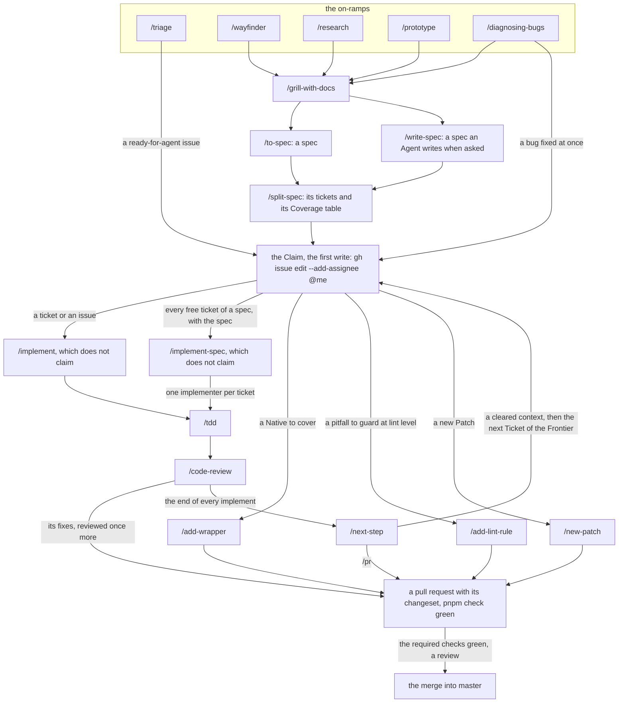

# The development loop

The development loop takes a piece of work from an on-ramp to a merged pull request, one Agent skill per step. Every one of them comes with the clone, in `.claude/skills/`.

## Where the Agent skills come from

- **The Upstream skills.** Every skill of the loop but the repository's own is an Upstream skill: a skill of [`mattpocock/skills`](https://github.com/mattpocock/skills), committed unmodified in `.claude/skills/` at the version [`skills-lock.json`](../../skills-lock.json) names ([Installing and updating the Upstream skills](#installing-and-updating-the-upstream-skills)). A local session and a cloud session load the same files from the checkout; nothing is installed per machine, and upstream's plugin is not used (ADR 0022). A global copy left from before shadows them: [Removing the global copies](#removing-the-global-copies).
- **The repository's.** The project skills `add-wrapper`, `add-lint-rule` and `new-patch`, and the Skill variants `write-spec`, `split-spec` and `next-step` ([Skill variants](#skill-variants)), live in `.claude/skills/` too, listed with their triggers under "Skills" in `AGENTS.md`.
- **One source for both repositories.** What both repositories run, the Upstream skills with their lock, the Skill variants that work issues on the Claim board (`write-spec`, `split-spec`, `next-step`), the session-start hook, the background-wait check (`.claude/hooks/background-wait.mjs`, #767) and the skill-target check (`.claude/hooks/skill-target.mjs`, #743), is written here, in the library, and the Template carries a copy of it (ADR 0024); the band of background work (`.claude/mods/background-band`, #769) is enabled from the library's marketplace by the shared settings, with no file of it copied to the Template. [`.claude/shared.json`](../../.claude/shared.json) names what is shared. A change to a shared skill or file is made here, never in the Template's copy.
- **Set up for this repository.** The three agents docs, [`issue-tracker.md`](issue-tracker.md), [`triage-labels.md`](triage-labels.md) and [`domain.md`](domain.md), are the output of `/setup-matt-pocock-skills`, with the "Agent skills" block of [`AGENTS.md`](../../AGENTS.md#agent-skills) that points at them. The Upstream skills read them for this repository's tracker, labels and domain docs; the repository has since edited them (the Claim, the kind labels), so they are its own: change a convention there, never in a skill.
- **Named in a diagram.** A diagram cites a folder of `.claude/skills/` by its slash command, an Upstream skill as well as one of the repository's own. A skill from anywhere else is declared, with its source, in the `external` list of `test/conventions/diagrams.test.ts`: add it there first.

## Installing and updating the Upstream skills

The Upstream skills are the skills of the `engineering` and `productivity` folders of [`mattpocock/skills`](https://github.com/mattpocock/skills), the set its plugin ships, copied into `.claude/skills/` for Claude Code at project scope (ADR 0022). [`skills-lock.json`](../../skills-lock.json) names each one with its source path and the hash of its folder. One command installs them and, run again, updates them to upstream's current files and rewrites the lock; run it from the repository root and commit the folders with the lock:

```sh
npx skills@1.7.4 add mattpocock/skills -a claude-code --copy -y -s ask-matt code-review codebase-design diagnosing-bugs domain-modeling grill-with-docs implement implement-spec improve-codebase-architecture pr prototype research retro setup-matt-pocock-skills tdd to-spec to-tickets triage wayfinder wizard grill-me grilling handoff teach to-questionnaire wait-what writing-for-agents
```

- **The skill names** are the `skills` of upstream's plugin manifest, [`.claude-plugin/plugin.json`](https://github.com/mattpocock/skills/blob/main/.claude-plugin/plugin.json): the folders of its `engineering` and `productivity` folders. A skill upstream adds there joins the list; one it moves to `in-progress`, `misc` or `deprecated` leaves it, and its folder and lock entry are removed with `npx skills@1.7.4 remove -y <name>`. The CLI skips a name that matches nothing without a word and still finds a name moved to `deprecated`, so the list is never trusted from memory: `pnpm skills:update` reads the manifest, removes what it no longer ships, installs the rest and rewrites the command above when the set changes. `release/test/skills-update.test.ts` holds the command above to the lock's names.
- **The line ends.** The CLI clones upstream with the machine's git configuration and hashes the files it copies. Git for Windows sets `core.autocrlf=true`, which turns upstream's LF into CRLF in the files and in the lock's hashes. On Windows, run the command in Git Bash with `GIT_CONFIG_COUNT=1 GIT_CONFIG_KEY_0=core.autocrlf GIT_CONFIG_VALUE_0=false` before it, so the files keep upstream's LF, as an install on Linux does.
- **Unmodified.** An Upstream skill is never edited by hand: git stores its files byte for byte, Prettier and ESLint skip them, and the skills conventions test (`test/conventions/skills.test.ts`) fails when a folder's files no longer give the hash the lock records. What the repository adds lives in its own Agent skills.
- **The variants.** An update that changes the Upstream skill a Skill variant was built from fails the same test until the variant is reviewed: [Skill variants](#skill-variants).
- **From the root scripts.** `pnpm skills:update` runs the same command for the manifest's names, with the line ends kept, then prints what moved in the lock (a folder's hash or its path in upstream) and the Skill variants left to review.

### The weekly update

Nobody needs to remember the update: [`skills-update.yml`](../../.github/workflows/skills-update.yml) runs it every Monday, in two steps, each a pull request under the repositories' GitHub App, so its CI runs. It never merges.

1. **The library.** It runs `pnpm skills:update` (on Linux, so the files keep upstream's LF), with no token: the skills CLI is code from npm, so the update leaves that job as a patch, and the job that holds the App's token commits it only once it has checked that the patch touches the lock, the Upstream skills' folders, this doc and its changeset, nothing else. Upstream moved when the update changes the lock; when it did not, nothing is opened. When it did, it opens a pull request from the branch `skills-update` with the update and an empty changeset: its diff is upstream's change, line by line, and its body lists the skills that moved and the Skill variants to review, which the skills conventions test turns red until each is reviewed. Push the review to that branch. A run while that pull request is open updates it instead of opening a second: when the branch already holds the same lock nothing is pushed, so the review stays; when upstream moved again, the branch is replaced from `master` and the body rewritten.
2. **The Template's copy.** It compares the Template's copy with what [`.claude/shared.json`](../../.claude/shared.json) names on `master` (`pnpm skills:copy`, which reads the Template's record of the copy, `.claude/shared.lock.json`). When the bytes differ, it replaces the copied files, deletes those no longer shared, rewrites the record's commit and hashes, and opens a pull request in the Template from its branch `sync/shared-skills`, replaced on every run that finds a difference. When they are the same, whatever commit the record names, nothing is opened. A library pull request from step 1 reaches the Template on the run after its merge.

Run it by hand, from `master` (its jobs that hold the App run in the environment `app`, which admits `master` alone), after merging a change to a shared skill or file:

```sh
gh workflow run skills-update.yml
```

`skills check` is not run: in `skills@1.7.4` it is another name of `skills update`, which reinstalls each skill as a symlink, without `--copy`, and for every agent it detects. The install above is the check.

### Skill variants

A Skill variant is an Agent skill of the repository built from an Upstream skill's steps, under its own name: `write-spec` is `to-spec`'s steps, `split-spec` is `to-tickets`' and `next-step` is `ask-matt`'s main flow from where an implement ends, each of which an Agent may invoke. An Agent skill that only invokes Upstream skills by name, without copying their steps, is not a variant and records nothing.

- **Its own name.** A variant never takes an Upstream skill's name, so a slash command always means one skill.
- **Its source, in its frontmatter.** Under `metadata`, `upstream` names the Upstream skill and `upstream-hash` records the lock's version of it when the variant was built or last reviewed. The lock holds no commit or version number per skill: a skill's version there is the `computedHash` of its folder, which changes exactly when one of the folder's files does. `upstream-hash` is that hash, copied from `skills-lock.json`:

  ```yaml
  metadata:
    upstream: to-spec
    upstream-hash: <the computedHash of to-spec in skills-lock.json>
  ```

- **Reviewed on every update.** The skills conventions test fails when a variant records an Upstream skill the lock does not name, or a hash that is not the lock's current one. After an update moves that hash, read the diff of the Upstream skill's folder, carry the changed steps into the variant where they apply, then copy the new hash into `upstream-hash`.
- **The human-only flag.** A variant may drop upstream's `disable-model-invocation: true`, so that an Agent or another skill can invoke it; its description then narrows the trigger to an explicit request or another skill's call, as `write-spec`'s does.

## Removing the global copies

In Claude Code a personal skill (`~/.claude/skills/<name>/`) wins over a project skill of the same name. A global copy of an Upstream skill, installed with the `skills` CLI before the skills came into the repository, therefore replaces the repository's without a word, and upstream's plugin `mattpocock-skills` loads every Upstream skill a second time under its own namespace (`mattpocock-skills:tdd`). Remove both once, naming the skills the warning below names:

```sh
npx skills remove -g <name>...
claude plugin uninstall mattpocock-skills@claude-plugins-official
```

A personal skill of your own that shares a repository skill's name is renamed or deleted by hand.

- **The warning.** The session-start hook [`.claude/hooks/shadowed-skills.mjs`](../../.claude/hooks/shadowed-skills.mjs), registered in the shared project settings [`.claude/settings.json`](../../.claude/settings.json), runs when a session starts or resumes. It names each personal skill that has the name of a folder of `.claude/skills/`, and the upstream plugin when `~/.claude/settings.json` enables it, with the command that removes them. Claude Code shows the warning in the session and gives it to the Agent too.
- **It never blocks.** The hook prints nothing when nothing shadows the repository's skills, always exits 0, and needs no `pnpm install`: it is dependency-free Node. Its test, `test/conventions/shadowed-skills.test.ts`, runs it against a fake home folder.

## The loop

An on-ramp shapes the work, the spec and its tickets fix it, the Claim takes it, and an implementation skill carries it to the pull request:



| Node               | Details in                                                                                                                                                                |
| ------------------ | ------------------------------------------------------------------------------------------------------------------------------------------------------------------------- |
| `/triage`          | [its `SKILL.md`](../../.claude/skills/triage/SKILL.md); the labels it applies: [`triage-labels.md`](triage-labels.md)                                                     |
| `/wayfinder`       | [its `SKILL.md`](../../.claude/skills/wayfinder/SKILL.md); its map and tickets: [Wayfinding operations](issue-tracker.md#wayfinding-operations)                           |
| `/research`        | [its `SKILL.md`](../../.claude/skills/research/SKILL.md)                                                                                                                  |
| `/prototype`       | [its `SKILL.md`](../../.claude/skills/prototype/SKILL.md)                                                                                                                 |
| `/diagnosing-bugs` | [its `SKILL.md`](../../.claude/skills/diagnosing-bugs/SKILL.md)                                                                                                           |
| `/grill-with-docs` | [its `SKILL.md`](../../.claude/skills/grill-with-docs/SKILL.md); the docs it reads and writes: [`domain.md`](domain.md)                                                   |
| `/to-spec`         | [its `SKILL.md`](../../.claude/skills/to-spec/SKILL.md); its label: [Kind labels](triage-labels.md#kind-labels)                                                           |
| `/write-spec`      | [its `SKILL.md`](../../.claude/skills/write-spec/SKILL.md); [Skill variants](#skill-variants); its labels: [Kind labels](triage-labels.md#kind-labels)                    |
| `/split-spec`      | [its `SKILL.md`](../../.claude/skills/split-spec/SKILL.md); [Skill variants](#skill-variants); its rule and table: [A Spec's coverage](issue-tracker.md#a-specs-coverage) |
| the Claim          | [Claim](issue-tracker.md#claim) in the issue tracker doc                                                                                                                  |
| `/implement`       | [its `SKILL.md`](../../.claude/skills/implement/SKILL.md)                                                                                                                 |
| `/implement-spec`  | [its `SKILL.md`](../../.claude/skills/implement-spec/SKILL.md)                                                                                                            |
| `/next-step`       | [its `SKILL.md`](../../.claude/skills/next-step/SKILL.md); [Skill variants](#skill-variants); added to the Agent's context by the skill-target check, under the table     |
| `/tdd`             | [its `SKILL.md`](../../.claude/skills/tdd/SKILL.md)                                                                                                                       |
| `/code-review`     | [its `SKILL.md`](../../.claude/skills/code-review/SKILL.md); its reviewers and the fix round: [Subagents](#subagents)                                                     |
| `/add-wrapper`     | [its `SKILL.md`](../../.claude/skills/add-wrapper/SKILL.md)                                                                                                               |
| `/add-lint-rule`   | [its `SKILL.md`](../../.claude/skills/add-lint-rule/SKILL.md); [Adding or changing a rule](../../packages/eslint-plugin-reforged/AGENTS.md#adding-or-changing-a-rule)     |
| `/new-patch`       | [its `SKILL.md`](../../.claude/skills/new-patch/SKILL.md); [New Patch loop](../../packages/reforged-types/AGENTS.md#new-patch-loop)                                       |
| a pull request     | [Pull requests](../../CONTRIBUTING.md#pull-requests) and [Changesets](../../CONTRIBUTING.md#changesets) in the contributing guide                                         |
| the merge          | [Pull requests](../../CONTRIBUTING.md#pull-requests): the required checks                                                                                                 |

- **The Claim is the first write**: `gh issue edit <n> --add-assignee @me` before the branch, the first commit, any comment and the pull request. `/implement` and `/implement-spec` do not claim by themselves: claim the ticket with its spec, the issue, or every free ticket of a spec with the spec, then invoke one. A spec is never claimed on its own, nor before its tickets; the on-ramps, triage and the split write without a Claim.
- **A project skill replaces `/implement`** for its task: `/add-wrapper` covers a Native, `/add-lint-rule` guards a pitfall at lint level, `/new-patch` adopts a Patch. Each carries its own steps to the pull request and its changeset.
- **`/implement` works one ticket or issue** on the current branch: `/tdd` at agreed seams, then `/code-review`. **`/implement-spec` works a whole spec** on one branch and one draft pull request closing its tickets, never the spec, which whoever merges closes after the coverage check ([Closing a Spec](issue-tracker.md#claim)): an implementer per ticket on the frontier of the task graph, each in its own worktree driving `/tdd`, a merger after each, then `/code-review` on the whole.
- **A skill pointed at the wrong issue stops** ([ADR 0025](../adr/0025-only-a-split-specs-unblocked-tickets-are-worked.md)). The skill-target check, [`.claude/hooks/skill-target.mjs`](../../.claude/hooks/skill-target.mjs), runs on a typed `/implement`, `/implement-spec`, `/ship-spec` or `/split-spec` and on a call of the Skill tool with one of them, so a skill another skill invokes is held to the same rule. It reads the first issue of the arguments (`734`, `#734`, `owner/repo#734` or its URL) and stops the skill, saying what to run instead: `/implement` on an issue with an open blocker (the blockers, and the takeable Tickets of its Spec from `pnpm spec:frontier`); `/implement`, `/implement-spec` or `/ship-spec` on a Spec with no Ticket (`/split-spec <n>` first); `/split-spec` on a Spec with Tickets and a Coverage table (nothing to split); `/split-spec`, `/implement-spec` or `/ship-spec` on a closed Spec, and `/implement` on a closed Ticket (closed, and by whom). An issue named in full is named in full again, and so is any issue of another repository than the clone's, in the reason and in the command it gives. The Upstream skills cannot carry the rule in their steps (ADR 0022), and the claim check stops a merge, not the work before it. When it lets `/implement` or `/implement-spec` through, it adds a line to the Agent's context: end the work with `next-step`, which prints at most five numbered next steps from the real state of the issue, its Spec and its pull request. With no issue reference it is silent; when `gh` or the network fails it lets the skill run with a one-line warning, since the claim check still holds the rule on the pull request.

## Subagents

An Agent that runs Subagents (`/implement-spec`, `/code-review`, any skill that hands a task to another Agent) follows these rules beside the Upstream skills, which stay unmodified (ADR 0022). Where a step of theirs says otherwise, the rule here wins.

- **Worktrees, made by hand.** Make each implementer's worktree yourself, from the integration branch, check its base before the Subagent starts, and give the Subagent its absolute path:

  ```sh
  git worktree add .claude/worktrees/<name> -b <branch> <integration-branch>
  git -C .claude/worktrees/<name> merge-base --is-ancestor <integration-branch> HEAD
  ```

  The Agent tool's worktree isolation stays unused: it refuses as unverifiable many commands this repository runs (a `cd` through a variable, the `GIT_CONFIG_COUNT=` prefix of the skills install, `gh --jq` with a newline). The Subagent's prompt says its worktree is already on the right base, and that a wrong base is reported, not repaired: the Subagent stops and says so, and never resets, though step 4 of `/implement-spec` tells it to reset onto the integration branch. Once a branch is merged, remove its worktree with `git worktree remove`. On Windows set `core.longpaths` first (`git config --global core.longpaths true`): without it the deep paths of `node_modules` stop the removal halfway, the worktree unregistered and its folder left behind.

- **Commands, in the foreground.** A Subagent runs every command in the foreground, with a timeout of at most ten minutes (`timeout: 600000`); a longer check is split into steps that each fit, `pnpm check` into `pnpm lint`, `pnpm typecheck`, `pnpm build`, `pnpm test` and the rest of its script. Only a completion notice wakes an Agent that waits on a background command, and it sometimes never comes: the process dies, or the waiter went idle first. The main conversation keeps background commands for real parallelism (a CI watch), each with a bounded runtime (a `timeout`, a runner's own limit), and stops what it started once it no longer needs it. An Agent ends a turn on a background wait only with something that wakes it, a Monitor or a scheduled wakeup that checks the condition; with neither, its reply says what is pending and how the Collaborator can check it. Subagents themselves may run in parallel: each is listed as in flight while it runs, and its completion notice is its report.
- **Spawn Subagents unnamed.** An unnamed Subagent hands back one report. A named agent is a teammate: each of its messages and idle notices arrives in the Collaborator's conversation as a turn of its own. A name is for an agent the Collaborator wants to talk to back and forth. An unnamed Subagent is still continued by its id, to hand it the review's findings.
- **The prompt.** A Subagent's prompt carries pointers (the issue, the Spec, the worktree's path, the commits) and these rules: commands in the foreground, no turn ended on a background wait, one report when done. Before writing it, read each criterion of the Ticket for a GitHub write: an issue comment, an `Outcome:` line, a line of the pull request's body. Permit each such write in the prompt, or make it yourself from the report.
- **Real state.** Before telling the Collaborator that something runs or progresses, the orchestrating Agent checks the list of agents (`ListAgents`), the processes, and the worktree's files and commits. A Subagent's own "still running" is a claim to check, never relayed as fact. When an idle notice says a Subagent waits on a background command, check at once; when nothing runs, send the Subagent a message that resumes the work.
- **Integration, checked before it moves.** The integration branch moves while implementers work, so the tip an implementer merged may be an old one, though its report says the tip. Before fast-forwarding the integration branch onto an implementer's branch, run `git merge-base --is-ancestor <integration-branch> <branch>`; when it fails, merge the current tip into that branch yourself and run again the checks the merge touches. `master` moves too: before `gh pr ready`, merge `origin/master` into the integration branch, run again the checks the merge touches, push, and confirm `gh pr view --json mergeStateStatus` is not `DIRTY`.
- **Review, by fresh Subagents.** `/code-review` runs its reviewers as fresh Subagents, as clean as a new session. Their prompt carries pointers only: the diff command, the standards, the issue and the Spec. The implementer's report, outcomes and justifications stay out of it, so its conclusions cannot steer the review.
- **Fixes, and one more round.** The implementer fixes what the review found, so the fix starts from the context that wrote the code. Then one more `/code-review` runs on the fix commits alone, by fresh Subagents: its fixed point is the last commit before the fixes. What it finds is fixed, and what stays a judgement call goes to the pull request's body. There is no third round. This round is what makes ADR 0021's "the pull request has been through `/code-review`, and what it found is fixed" verifiable.

### What the background-wait check blocks

The background-wait check is one script, [`.claude/hooks/background-wait.mjs`](../../.claude/hooks/background-wait.mjs), on two hooks of the shared settings, `PreToolUse` and `Stop`. It blocks two things, wherever hooks run, `claude -p` and cloud sessions included:

- **A Subagent's background command.** A Bash or PowerShell call with `run_in_background` from a Subagent is denied, with the reason: run it in the foreground within ten minutes, or split it. The main conversation's pass.
- **An empty wait.** A turn whose last reply says it waits on background work, while the Stop lists no background task and no session cron, is blocked once: the Agent is told to verify, then resume the work or say plainly that nothing runs. A wait the reply only quotes does not count, so a retrospective or the report of a stall passes: a code span or block, curly quotes, guillemets, or straight quotes that open and close at a word's edge. A `>` line counts, since an Agent writes its own status in one. The stop after that passes, so a false alarm costs one verification and never a loop.

What it sees of an idle teammate, from [#768's `Outcome:`](https://github.com/phmilk/reforged-ts/issues/768#issuecomment-6441630181): in an interactive session a named agent left idle after its report is listed among the Stop's background tasks as a running teammate, so a wait on it passes, though it sends nothing more until it gets a message. In `claude -p` a named agent is no teammate: it ends `completed`, is absent from the background tasks, and a reply that waits on it is blocked once. Unnamed Subagents are seen alike in both.
